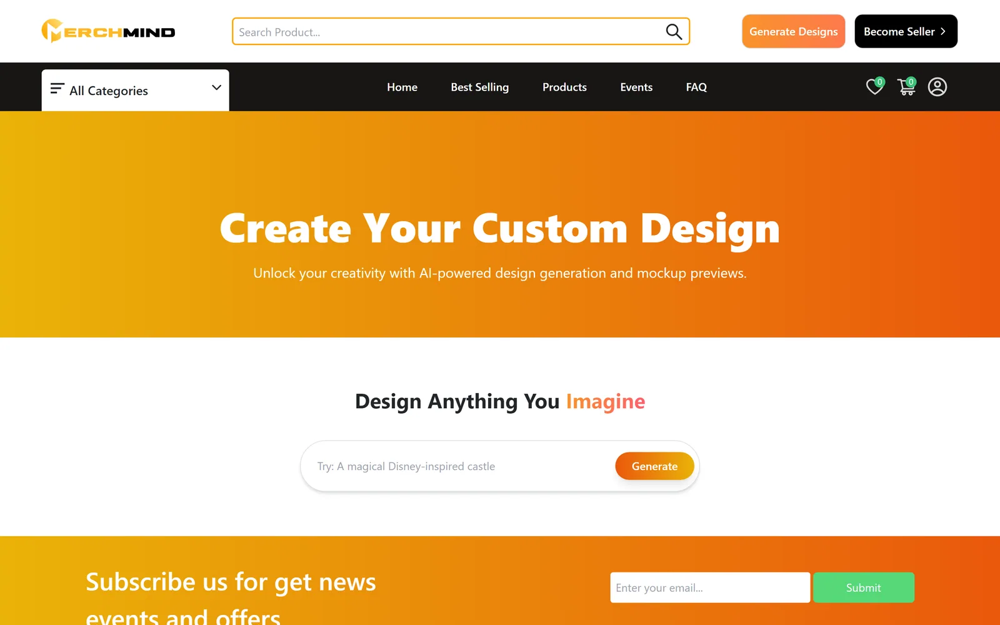
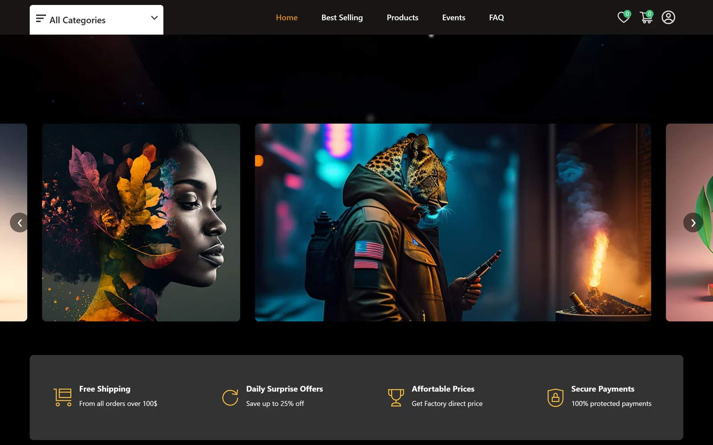
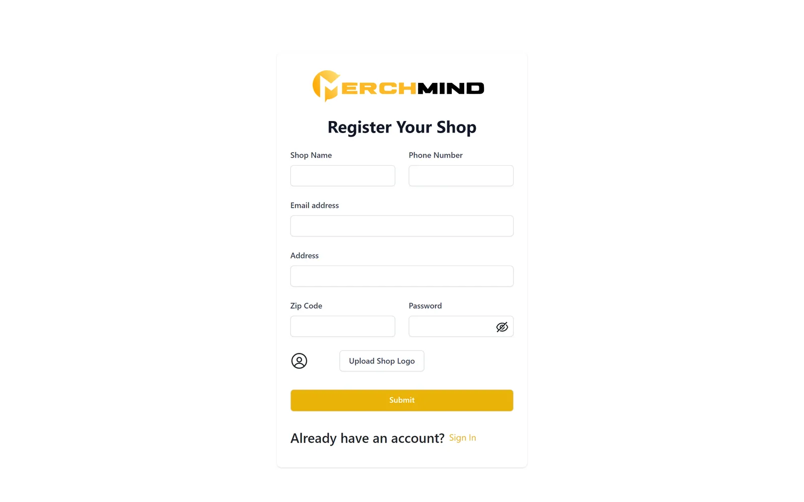

<div align="center">

# MerchMind

**A custom printing and merch marketplace where shoppers describe a design in words, generate it with AI and preview it on products.**

[Live demo](https://merchmind.netlify.app) · [Backend API repo](https://github.com/farhadnazir/merchmind-backend) · [Case study](https://farhadnazir.com/projects/merchmind/)


</div>


> **Status:** final-year project. The frontend is live on Netlify, but the backend API is no longer hosted, so the live demo shows the interface without store data (products, sign-in and checkout do not load). Open the demo from the home page: Netlify has no single-page-app redirect configured, so direct links to inner pages return 404.

## About

MerchMind is the React frontend of a MERN-stack marketplace for custom printing and merchandise. A shopper types a short prompt, the app generates an artwork with an AI image API and places it onto eight product mockups for side-by-side comparison. Around that design flow sits a multi-vendor store with three roles: customers, sellers who run their own shops, and an admin.

The REST API lives in a separate repository: [farhadnazir/merchmind-backend](https://github.com/farhadnazir/merchmind-backend).

## Features

- **AI design studio** (`/generate-your-own`): enter a prompt and get an AI-generated artwork back. Prompts are wrapped in a quality template before they are sent to the DeepAI text-to-image API, with loading and error states.
- **Product mockups:** one click renders the design onto eight product templates in parallel through the Dynamic Mockups API (`Promise.all`, failed renders are filtered out). The mockup grid has quantity and Add to Cart controls, which are not yet wired to the cart.
- **Design download:** save the generated artwork as a JPG from the browser.
- **Customer storefront:** home, best selling, products, product details with ratings and reviews, events with countdowns, FAQ, wishlist, cart, multi-step checkout, profile, order details and order tracking.
- **Checkout:** Stripe card payments (the publishable key is fetched from the API at runtime), PayPal buttons and cash on delivery.
- **Seller shops:** registration with email activation, plus a dashboard for products, timed events, coupon codes, orders, refunds, shop settings, withdrawals and an inbox.
- **Admin dashboard:** all users, sellers, orders, products, events and seller withdrawal requests.
- **Buyer and seller messaging:** chat through `socket.io-client` (see the configuration notes below).
- **Role-based routes:** separate protected routes for customers, sellers and admins.

## Screenshots

| AI design studio | Home page artwork carousel |
|---|---|
|  |  |
| **Seller registration** | |
|  | |

Screenshots were captured from the live demo in November 2026. Pages that need the API (products, events, dashboards) are not shown because the backend is offline.

## Tech stack

| Area | Technology |
|---|---|
| UI | React 18 (Create React App, `react-scripts` 5), React Router 6 |
| State | Redux, Redux Toolkit, redux-thunk |
| Styling | Tailwind CSS 3, Material UI 4 (data grids in the dashboards), react-toastify, Lottie |
| Payments | Stripe Elements (`@stripe/react-stripe-js`), PayPal (`@paypal/react-paypal-js`) |
| AI services | DeepAI text-to-image, Dynamic Mockups render API |
| Real-time | `socket.io-client` |
| HTTP | axios, with cookie-based sessions (`withCredentials`) |
| Hosting | Netlify |

## Getting started

### Prerequisites

- Node.js 18 and npm
- A running copy of the [MerchMind backend](https://github.com/farhadnazir/merchmind-backend)

### Install and run

```bash
git clone https://github.com/farhadnazir/MerchMind-AI-Platform.git
cd MerchMind-AI-Platform
npm install
npm start          # development server on http://localhost:3000
```

### Configuration

The app does not read environment variables. Settings live in the source:

| What | Where |
|---|---|
| Backend URL | `src/server.js` (`backend_url`, and `server`, which ends in `/api/v2`). Both point at a Railway deployment that is now offline; change them to your backend, for example `http://localhost:<PORT>`. |
| CORS | The backend only allows `https://merchmind.netlify.app`. For local development, add `http://localhost:3000` to the `cors` origins in the backend's `app.js`. |
| AI design studio | `src/pages/newPages/CustomDesignPage.jsx` calls DeepAI and Dynamic Mockups from the browser. Use your own API keys for both services. |
| Chat server | `ENDPOINT` in `src/pages/UserInbox.jsx` and `src/components/Shop/DashboardMessages.jsx`. Chat needs a separate Socket.IO server, which is not part of these repositories; the configured one is offline. |

### Scripts

| Command | What it does |
|---|---|
| `npm start` | Start the development server |
| `npm run build` | Create a production build in `build/` |
| `npm test` | Run the Create React App test runner |

## Project structure

```text
src/
  components/   UI by area (Admin, Shop, Products, Checkout, Payment, Layout, ...)
  pages/        Route pages; pages/newPages/CustomDesignPage.jsx is the AI design studio
  redux/        Actions, reducers and store
  routes/       Route lists and the customer, seller and admin route guards
  static/       Navigation, categories and sample data
  server.js     Backend URLs
```

## Credits

MerchMind was built by **Farhad Nazir** and **Amish Naeem** as their final-year project. The marketplace layer builds on an existing multi-vendor MERN e-shop codebase that was adapted and rebranded (the footer still carries that codebase's copyright line). The AI design studio, the mockup pipeline and the MerchMind branding are the project's own additions.

## Links

- Live demo: https://merchmind.netlify.app
- Backend API: https://github.com/farhadnazir/merchmind-backend
- Case study: https://farhadnazir.com/projects/merchmind/

## Author

**Farhad Nazir**, full-stack software developer

- Website: [farhadnazir.com](https://farhadnazir.com)
- LinkedIn: [linkedin.com/in/farhadnazir](https://www.linkedin.com/in/farhadnazir)
- GitHub: [github.com/farhadnazir](https://github.com/farhadnazir)
- Email: [farhadnazirksa@gmail.com](mailto:farhadnazirksa@gmail.com)
