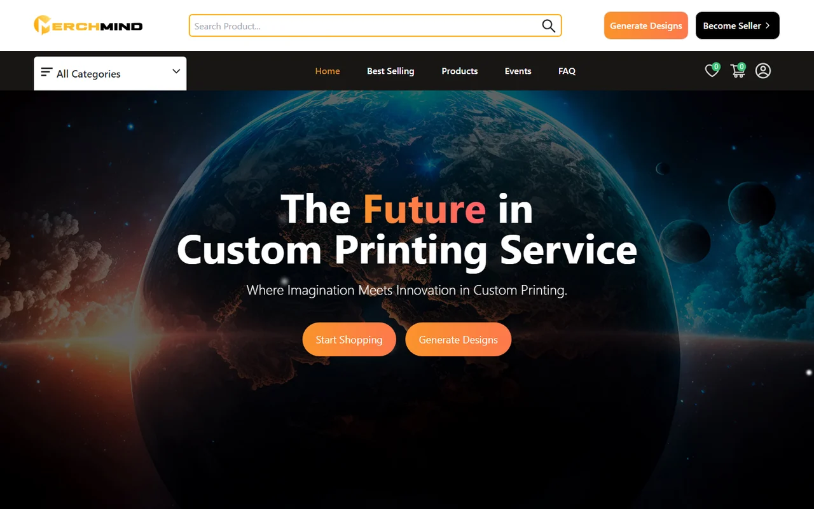

<div align="center">

# 🎨 MerchMind AI
**AI-powered custom printing & merch marketplace**

<p>
  
  
  
  
  
  
</p>

<a href="https://merchmind.netlify.app"><b>🌐 Live demo: merchmind.netlify.app</b></a>

</div>

<p align="center">
  
</p>

---

## ⚡ Overview

**MerchMind** lets anyone turn an idea into a printed product. Describe a design in words, let AI generate it, preview it on real products (t-shirts, mugs, hoodies and more) and order it. Independent sellers can open their own shop on the platform and sell their designs.

## ✨ Key Features

- **🤖 AI design generation:** text-to-image designs from a simple prompt.
- **👕 Product mockups:** see the design on real products before ordering.
- **🏪 Multi-vendor marketplace:** sellers create shops, list products, run events and coupon codes, and request withdrawals of their earnings.
- **🛒 Shopping & checkout:** categories, best sellers, wishlist, cart, checkout and order tracking.
- **💳 Payments:** Stripe and PayPal.
- **💬 Real-time inbox:** buyers and sellers chat live (Socket.IO).
- **🛡️ Admin dashboard:** manage users, sellers, products, orders, events and withdrawals.
- **📧 Account activation by email** and secure JWT sign-in.

## 🛠️ Tech Stack

| Layer | Technology |
|---|---|
| Frontend | React 18, Redux Toolkit, React Router, Tailwind CSS, Material UI |
| Backend | Node.js, Express ([merchmind-backend](https://github.com/farhadnazir/merchmind-backend)) |
| Database | MongoDB (Mongoose) |
| Media | Cloudinary |
| AI | Text-to-image generation APIs, product mockup rendering |
| Payments | Stripe, PayPal |
| Real-time | Socket.IO |
| Hosting | Netlify (frontend), Vercel (backend) |

## 🚀 Run Locally

```bash
git clone https://github.com/farhadnazir/MerchMind-AI-Platform.git
cd MerchMind-AI-Platform
npm install
# create a .env file with REACT_APP_API_URL pointing to your backend
npm start
```

The backend lives in [farhadnazir/merchmind-backend](https://github.com/farhadnazir/merchmind-backend).

---

## 👨‍💻 Developed By

**Farhad Nazir** & **Amish Naeem**

* 🌐 **GitHub:** [github.com/farhadnazir](https://github.com/farhadnazir)
* 💼 **LinkedIn:** [linkedin.com/in/farhadnazir](https://www.linkedin.com/in/farhadnazir)
* 📫 **Email:** farhadnazir1111@gmail.com

> Also by me: [**Asaan Optics**](https://github.com/farhadnazir/Asaan-Optics-App-Official), POS and shop management for optical shops on Android, Windows and iPhone/iPad.
